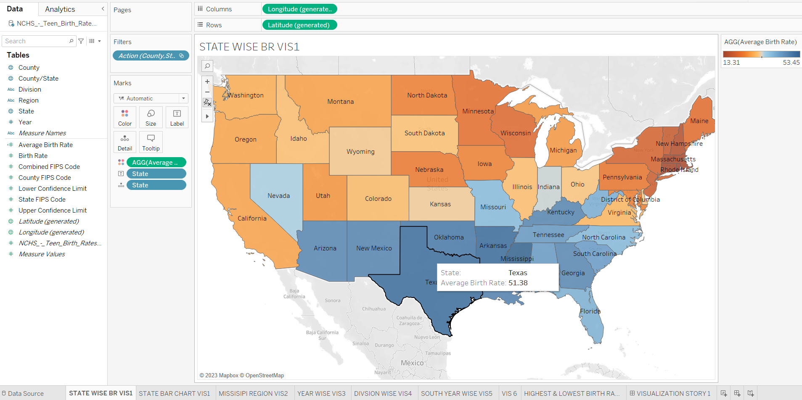
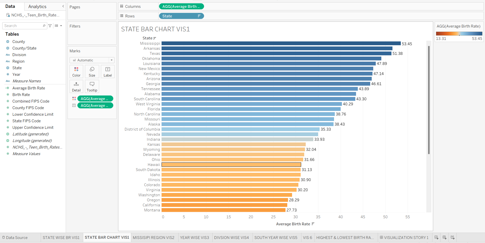
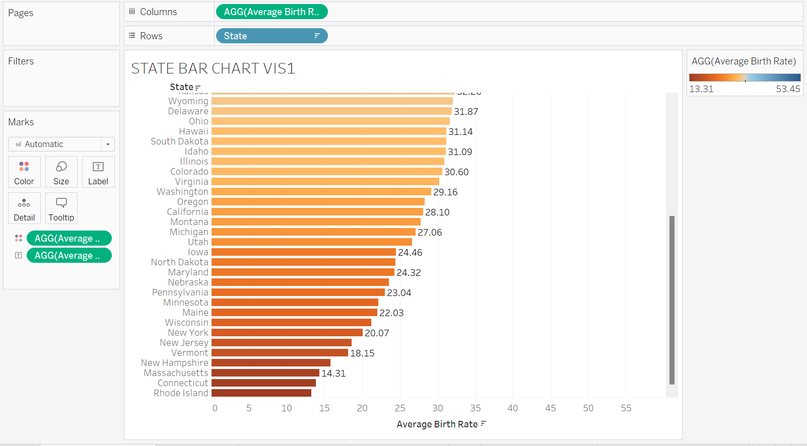
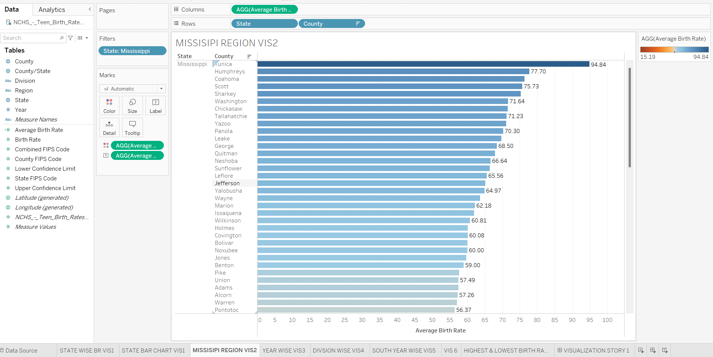
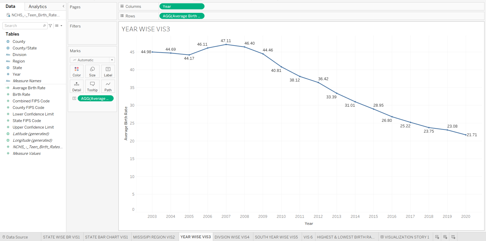
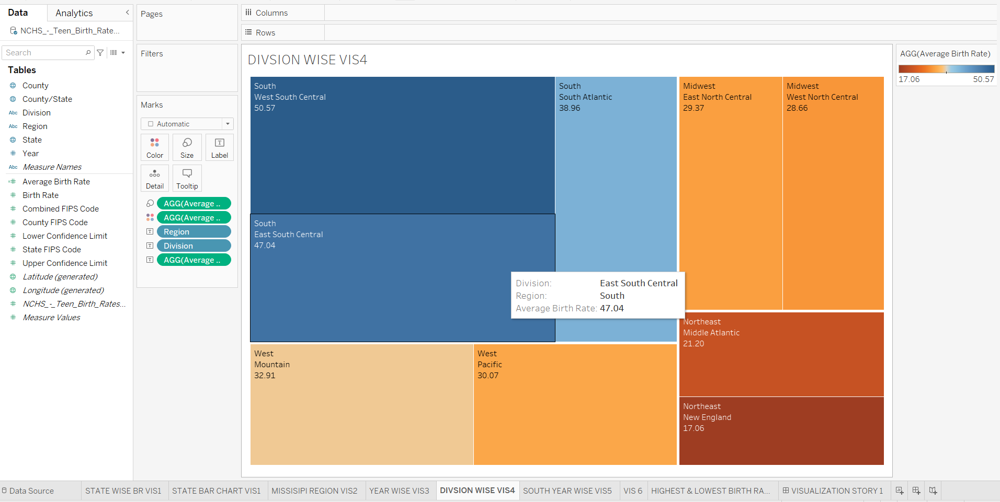
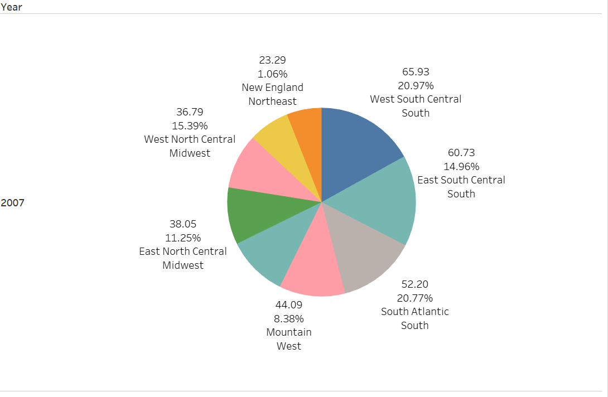
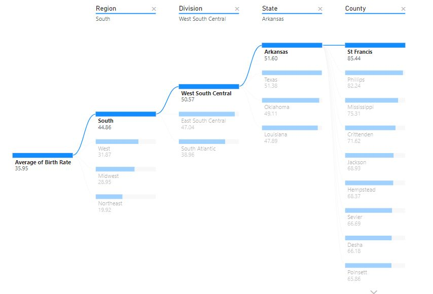
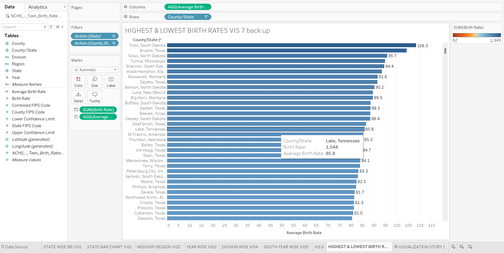
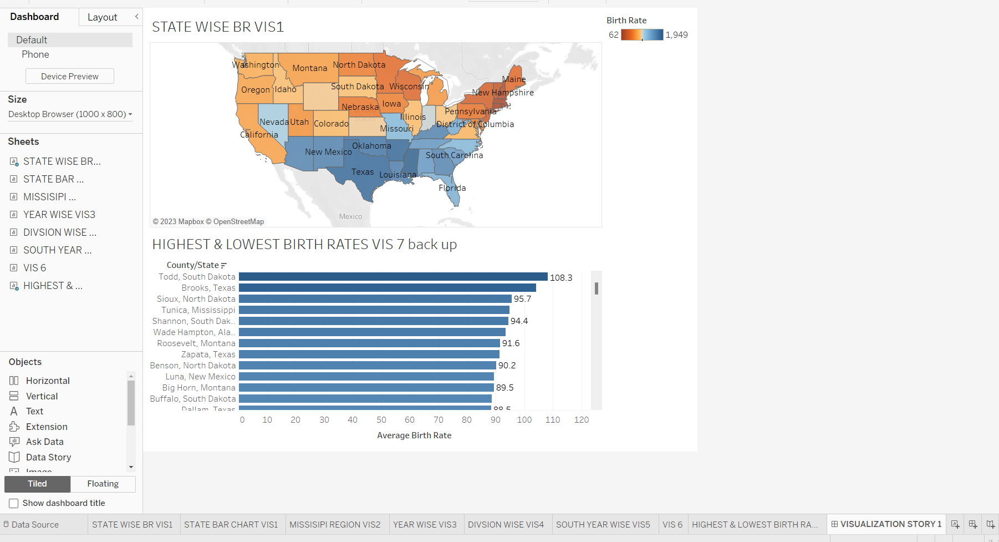

# Data Storytelling: Teen Birth Rates in the U.S.

A data storytelling project analysing **adolescent birth rates (ages 15–19) across U.S. counties**, built with **Tableau** and **Power BI**.

Done under **Prof. Jacob Shortt**'s lecture at **NMIMS**, in collaboration with **Virginia Tech**.

## The data

[`NCH_TBR_AGE 15-19_in_the_US_by_County.xlsx`](NCH_TBR_AGE%2015-19_in_the_US_by_County.xlsx) is based on the NCHS (National Center for Health Statistics) dataset *Teen Birth Rates for Age Group 15–19 in the United States by County*. Each row is one county in one year:

| Column | Meaning |
|---|---|
| `Year` | Year of the estimate |
| `State`, `County`, `County/State` | Location |
| `Region`, `Division` | U.S. Census region (4) and division (9), added by us from a second dataset |
| `State FIPS Code`, `County FIPS Code`, `Combined FIPS Code` | Standard geographic codes, used for mapping |
| `Birth Rate` | Estimated births per 1,000 females aged 15–19 |
| `Lower Confidence Limit`, `Upper Confidence Limit` | Confidence interval around the estimate |

### What we did with it

1. **Cleaned it**: checked for inconsistencies, duplicates and missing values.
2. **Enriched it**: joined in Census regions and divisions so we could compare larger areas, not only states.
3. **Visualised it** in Tableau and Power BI to tell the story below.

## Findings

All numbers are average birth rates (births per 1,000 females aged 15–19) over the years in the data.

### 1. By state

Mississippi has the highest average (**53.45**) and Rhode Island the lowest (**13.31**). The South (blue) is consistently higher than the North (orange).

### 2. Mississippi by county

Most Mississippi counties fall between 40 and 60. Tunica is the highest (**94.84**) and Lafayette the lowest (**15.19**).

### 3. Over time

The national average dipped slightly from 2003 to 2005 (44.98 → 44.17), then rose to a peak of **47.11 in 2007**. After that it fell steadily, down to **21.71 by 2020**, roughly half the peak.

### 4. By region and division

The South leads, with West South Central (**50.57**) and East South Central (47.04) at the top. The Mountain division leads the West (32.91) and East North Central leads the Midwest (29.37). New England is the lowest (**17.06**). Within the South, Maryland is the lowest state (24.32).

Over the years, all three southern divisions follow the national pattern: a fall to 2005, a peak in 2007 and a decline after. South Atlantic stays the lowest of the three, peaking at 52.20.

### 5. 2007 snapshot

In the peak year, West South Central was the highest (65.93) and New England the lowest (23.29). The three southern divisions together make up more than half of the total.

### 6. Drilling down (Power BI decomposition tree)

Following the highest value at each level gives South (44.86) → West South Central (50.57) → Arkansas (51.60) → **St. Francis County (85.44)**.

### 7. Highest counties nationally

Todd County, South Dakota, has the highest average of any county (**108.3**). It's followed by Brooks, Texas; Sioux, North Dakota; and Tunica, Mississippi. Texas appears more often than any other state in the top ranks.

### Dashboard

The Tableau dashboard puts the state map next to the county ranking. Clicking a state filters the counties.

## Files

| File | What it is |
|---|---|
| `Data Story Telling Project.twb` | Tableau workbook (state map, yearly trend, Mississippi, division and South analyses) |
| `Data Story Telling Project Power BI.pbix` | Power BI report (incl. pie chart and decomposition tree) |
| `Data Story Telling Project Report.docx` | Written report of the analysis |
| `Data Story Telling Project ppt.pptx` | Presentation slides |
| `NCH_TBR_AGE 15-19_in_the_US_by_County.xlsx` | The dataset |
| `images/` | Chart screenshots taken from the slides |

## How to open

- **Tableau**: open the `.twb` in Tableau Desktop or Tableau Public. It reads the `.xlsx` from the same folder, so keep both files together.
- **Power BI**: open the `.pbix` in Power BI Desktop. If it asks for the data source, point it at the `.xlsx` in this repo (*Transform data → Data source settings*).

## License

See [LICENSE](LICENSE).
